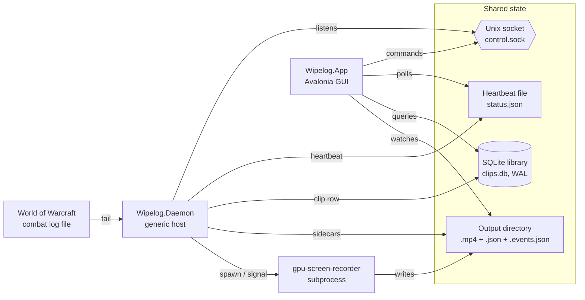

# Architecture

This document has two halves. The first is a **system overview** — what
the processes are, how they talk, and where data lives on disk. The
second is the **phase history**, kept because some design choices only
make sense if you know the order they happened in.

If you're new to the codebase, read the system overview, then jump to
[`../CLAUDE.md`](../CLAUDE.md) for the implementation specifics
(identity resolution, damage parsing, schema migrations, etc.). The
phase history is reference material.

## System overview

### Two processes, one library

Wipelog runs as two cooperating processes:

- **`Wipelog.Daemon`** is a long-running console host (built on
  `Microsoft.Extensions.Hosting`). It tails the WoW combat log, runs
  the encounter detector, manages `gpu-screen-recorder` as a child
  process, and writes clip metadata to the SQLite library.
- **`Wipelog.App`** is the Avalonia GUI. It reads the same SQLite
  library, watches the output directory for new clip files, and plays
  clips back via embedded LibVLCSharp.

Neither process is the other's master: the daemon is started either
directly from a shell or as a `systemd --user` unit (see
[`../packaging/`](../packaging/README.md)), and the GUI can be launched
or closed independently. They share state through three on-disk
mechanisms — they do **not** open a network or D-Bus channel to each
other.



### What they share

| Channel | Path | Direction | Purpose |
|---|---|---|---|
| **SQLite library** | `~/.local/share/wipelog/clips.db` (override with `--db-path`) | Daemon writes, GUI reads. Both open in WAL mode so reads don't block writes. | Clip metadata, tags, notes. |
| **Output directory** | `--output <dir>` on the daemon | Daemon writes `.mp4` + `.json` + `.events.json`; GUI's `LibraryWatcher` (`Wipelog.App/Services/LibraryWatcher.cs`) reacts to file events. | Video files and per-clip sidecars. |
| **Heartbeat file** | `$XDG_CACHE_HOME/wipelog/status.json` (default `~/.cache/wipelog/status.json`) — see `HeartbeatWriter.cs:61` | Daemon writes every ~2 s; `FileBasedDaemonStatusReader` (`Wipelog.App/Services/FileBasedDaemonStatusReader.cs:75`) polls it. | Liveness, current recording, ACL warning flag. |
| **Control socket** | `$XDG_RUNTIME_DIR/wipelog/control.sock` (fallback `/tmp/wipelog-{uid}/control.sock`) — `ControlSocketPath.Resolve()` in `Wipelog.Core/Control/ControlProtocol.cs` | GUI dials, daemon listens. One JSON request → one JSON response → close. | Manual record / stop commands from the Record and Stop buttons. |
| **Preferences** | `~/.config/wipelog/preferences.json` (GUI owns the file; daemon reads it on startup via `UserPreferencesService.Load`) | GUI writes, daemon reads. | Notification toggles, log/output paths chosen in Settings. |

The two processes are deliberately decoupled. The daemon doesn't know
the GUI exists (the control socket is optional — `stopRecording` is
only sent when the user clicks Stop). The GUI degrades gracefully when
the daemon isn't running: the status reader reports `Unreachable`, the
sidebar shows "Daemon not running", and clip playback still works
because clips on disk are the source of truth.

### How a clip happens

1. **WoW writes a line** to `Logs/WoWCombatLog-YYYYMMDD_HHMMSS.txt`.
2. The daemon's `LogTailer` (`Wipelog.Core.CombatLog.LogTailer`) has a
   `FileSystemWatcher` on the log directory and tracks a byte offset
   per file. New bytes are read, framed into lines, and parsed by
   `CombatLogParser` into typed `CombatLogEvent` records.
3. Events flow through a `Channel<CombatLogEvent>` into
   `RecorderController.RunAsync`
   (`Wipelog.Core.Recording.RecorderController`).
4. The controller hands each event to `EncounterDetector` — a pure
   state machine that emits `StartRecording` / `StopRecording` commands
   — and to two buffers: an identity buffer (for the spec resolver) and
   a `RecordingEventBuffer` that captures deaths and encounter
   boundaries with kill-blow attribution.
5. On `StartRecording`, the controller launches `gpu-screen-recorder` —
   which writes to a hidden temp file `.NAME.recording.mp4` — and, if
   `--preroll-seconds N` was passed, flushes the parallel pre-roll
   recorder via SIGUSR1.
6. On `StopRecording`, the controller waits for the recorder to flush,
   renames the temp file to its final name, optionally prepends the
   pre-roll segment via `ffmpeg` stream-copy concat, runs the player
   spec resolver, builds the timeline event document, writes the two
   sidecar JSON files, and inserts a row into the library through
   `IClipRecorderSink` (implemented by `Wipelog.Daemon.LibrarySink`).
7. The GUI's `LibraryWatcher` sees the new `.mp4` land and refreshes
   the clip list. The user clicks the row; `PlayerView` loads the
   video in a `VideoView` (LibVLCSharp.Avalonia) and the scrub bar
   loads the `.events.json` to draw tombstones.

CLAUDE.md's "Recording lifecycle" section covers the exact buffer rules
and pitfalls (kill-blow attribution happens at `UnitDied` observation
time, not at `Build()` — re-reading the relevant commits matters before
touching `RecordingEventBuffer`).

### How configuration flows

There are two configuration channels and they don't fully agree, by
design:

- **Daemon CLI flags** (`--log-dir`, `--output`, `--codec`,
  `--preroll-seconds`, etc.) — parsed in `Wipelog.Daemon/Program.cs`
  from `args`. These are how a shell invocation or the systemd unit
  configures the daemon. They're authoritative for the running
  daemon's behaviour.
- **`preferences.json`** — written by the GUI's Settings view, read by
  the daemon on startup (`UserPreferencesService.Load` in
  `Wipelog.Core.Preferences`). Today the daemon only consumes the
  notification toggles (`NotifyOnClipSaved`, `NotifyOnErrors`); the
  log and output paths in the file are GUI-only hints used to render
  the Settings view and the first-run banner.

This means restarting the daemon is required for any preferences
change that crosses into daemon behaviour. The Settings view's
"Restart daemon" affordance covers this for users on the systemd unit;
users running the daemon directly restart the shell process by hand.

## Phase history

Wipelog was built up in phases so each layer could be exercised in
isolation before the next one landed. The early phases shipped the
recording pipeline, the combat-event sidecar, and the GUI base. A
later pass replaced an icon-rail layout with the current three-column
"hidden castle" sidebar. PvP coverage and the v2 sidecar + bulk
operations landed in parallel with that layout change.

### Phases

1. **Combat log parser** *(done)* — pure-function transformation
   from raw `WoWCombatLog.txt` lines into typed `CombatLogEvent` records.
   Lives in `Wipelog.Core.CombatLog`. Tolerant of partial writes,
   year-less timestamps, and unknown event names. The top-level comma
   splitter preserves `[1,2,3]` arrays and `"quoted, names"` as single
   fields — don't replace it with a generic CSV parser.

2. **File tailer + state machine** *(done)* — `LogTailer`
   watches the combat-log file via `FileSystemWatcher`, tracks a byte
   offset, buffers partial lines, and pushes parsed events into a
   `Channel<CombatLogEvent>`. Tail-from-end semantics; resets on
   truncation or replacement. `EncounterDetector` (in
   `Wipelog.Core.Detection`) is a pure state machine that consumes
   the event stream and emits `StartRecording` / `StopRecording`
   commands, with safety timeouts evaluated against event timestamps.

3. **Recorder process wrapper** *(done)* — `GpuScreenRecorder`
   in `Wipelog.Core.Recording` wraps the `gpu-screen-recorder` CLI as
   a subprocess: sends SIGINT for graceful stop (with a 10s SIGKILL
   fallback), SIGUSR1 to flush the replay buffer. `RecorderController`
   glues the detector to the recorder, writes to a hidden temp file
   while recording, renames it on stop, and emits three sidecars next
   to the `.mp4`: the main metadata JSON, a versioned `.events.json`,
   and a row in the SQLite library. The `Wipelog.Daemon` console app
   composes everything via the generic host with command-line config.

4. **Library + GUI base** *(done)* — `Wipelog.Library`
   exposes a Dapper-backed SQLite repository (WAL mode) shared by
   daemon and GUI. The daemon writes a row after every finalized
   clip; an indexer reconciles the DB with the on-disk sidecars at
   startup (and via `Wipelog.Daemon index`). `Wipelog.App` is an
   Avalonia 11 desktop GUI; FilesystemWatcher on the output directory
   keeps the GUI live while recording. Window state persists to
   `~/.config/wipelog/window.json`.

5. **Synced timeline** *(done)* — combat-event sidecar
   (`.events.json`) written by the daemon at stop, a ribbon below the
   player video, and click-to-seek wired into the existing player view
   model. Per-clip player deaths (with killing-blow source/spell looked
   up from a 5-second rolling damage window) plus M+ inner-boss starts
   render as 🪦 tombstones and yellow encounter bars on a unified
   scrub-bar widget. Raid clips have an empty boss track because the
   triggering encounter would duplicate the clip header.

6. **Table-first GUI** *(superseded)* — 64 px icon rail with
   `M+ / Raid / All` content selector + filter popovers, a center
   column stacking the player + timeline over a DataGrid-based clip
   table, and a right-side details panel. Kept here for context; the
   rail and popovers are gone, but the DataGrid and details panel
   carried over to the current layout.

7. **PvP coverage + Arena outcomes** *(done)* — the
   `ContentType` enum gained `Arena`, `SoloShuffle`, `Battleground`,
   and `RatedBattleground`. Arena and Solo Shuffle are detected from
   `ARENA_MATCH_START` (Solo Shuffle disambiguated by the `"Shuffle"`
   bracket field); BGs are detected from `ZONE_CHANGE` into a known BG
   map ID. `ArenaBracket` ("Arena3v3", "Rated Solo Shuffle", …) persists
   through migration `005_arena_bracket.sql` and on the sidecar JSON.
   Arena win/loss resolves at finalize by cross-referencing
   `ARENA_MATCH_END.WinningFaction` with `COMBATANT_INFO.Faction`; the
   placeholder `_complete.mp4` suffix is rewritten to `_win.mp4` or
   `_loss.mp4` and `Success` reflects the outcome. Solo Shuffle and BGs
   keep `_complete` until a cleaner signal is plumbed.

8. **Hidden castle layout + bulk ops** *(done, current)* —
   the earlier icon rail is replaced by a labeled 220 px sidebar on
   the left (Status pill, six Recordings categories with per-type
   counts, Settings entries docked to the bottom). The center column carries
   the player + scrub-bar-with-tombstones widget, an inline filter bar
   of segmented controls (Deaths · All/Own/None, Encounters · On/Off,
   Favorites ★, Search, Date range), and the clip table. A 300 px
   content-type-aware details panel on the right shows per-content
   metadata (Encounter/Difficulty for raids, Keystone for M+, Bracket
   for Arena/Solo Shuffle, Map for Battlegrounds), Character/Spec, and
   a raid-comp chip strip (🛡 / ✚ / ⚔ / 💀) fed by the `.events.json`
   sidecar's `combatants` list. Favorite + delete live on the row
   (★ icon, right-click "Delete…") and metadata editing goes through
   "Edit metadata…" in the context menu. Ctrl/Shift-click multi-select
   flips the table footer into a `[Delete] [Archive] [Clear]` action
   bar — bulk delete is one DB transaction with a best-effort file
   sweep across the three files per clip; bulk archive streams the
   selection into a single `.zip` (mp4 stored uncompressed, sidecars
   deflated fastest) with a cancellable progress dialog.

   The `.events.json` sidecar is now versioned `v2`: it adds a
   top-level `combatants` list (one record per player GUID with
   `specId`, `class`, `spec`, `role`) for the raid-comp chip strip.
   V1 readers see the absent field as an empty list and stay functional.
   Run `Wipelog.Daemon backfill-events --force` after upgrading past
   schema v2 to regenerate the `combatants` list into old clips.

## Layout

```
src/
  Wipelog.Core/      # combat-log parser, tailer, detector, gpu-screen-recorder wrapper,
                     # encounter state machine, recording event buffer, timeline sidecar
  Wipelog.Library/   # SQLite + Dapper clip repository, migrations, indexer, bulk delete
  Wipelog.Daemon/    # console host (generic host) wiring everything together;
                     # `index` and `backfill-events` subcommands
  Wipelog.App/       # Avalonia 11 GUI
tests/
  Wipelog.Core.Tests/
```

Core stays free of UI and DB dependencies. Library depends on Core only
for `ContentType` + `PlayerIdentity`. The Daemon wires Core + Library
together; the App wires Library directly. See [`../CLAUDE.md`](../CLAUDE.md)
for current-state implementation notes (identity resolution, damage
parsing, schema migrations, bulk operations, filter bar, details panel)
that pair with this phase list.
